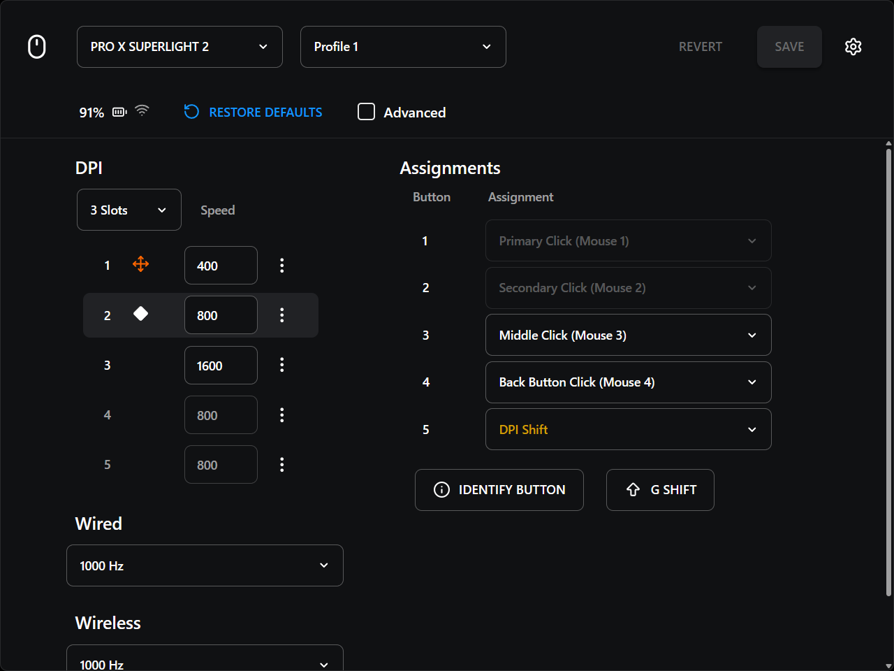

# OMM Web

> [!NOTE]
> This project is vibecoded and I do not take no responsibility for anything it does.

Configure the onboard memory of Logitech G mice from the browser, using WebHID.
An unofficial web take on Logitech's Onboard Memory Manager, written for the
PRO X SUPERLIGHT 2. Not affiliated with or endorsed by Logitech.

<h2 align="center"><a href="https://lnx00.github.io/lomm-web/">Open OMM Web</a></h2>

  

## Requirements

- A Chromium based desktop browser (Chrome, Edge, Opera). Firefox and Safari do not implement WebHID.
- Close G HUB first. It keeps the device busy and can switch it out of onboard mode.

## Features

- DPI slots: values, slot count, profile default, DPI shift slot, set current DPI
- Advanced DPI on sensors that support it: separate y-axis, lift off distance
- Button assignments, including the G-Shift layer and recorded keystrokes
- Report rate (wired and wireless where the mouse has both)
- BHOP mode on mice that have it
- Multiple profiles: switch, enable and disable
- Restore factory defaults, revert unsaved edits
- Battery level, host mode warning with a switch back to onboard mode
- Identify button (the mouse buttons do nothing while it waits for a press)

Not implemented yet: receiver pairing, lighting effects, HITS (analog button)
configuration and macros. Existing macros show as "Macro not supported" and are
left untouched.

## A word of caution

Saving writes to the mouse's flash memory. The protocol handling follows what the
official tool does, but it has so far only been exercised against the built-in
simulated mouse, not verified on real hardware. If something looks off after a
save, "Restore Defaults" copies the factory profile back.

## Development

See [docs/development.md](docs/development.md) for running it locally, the demo
modes and the code layout.
